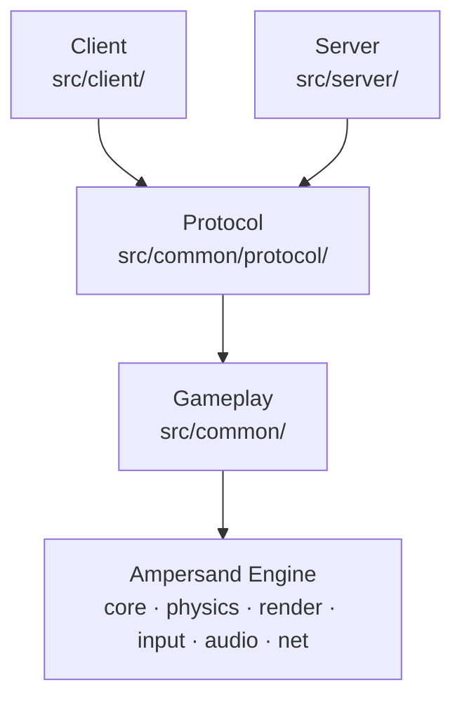

# Architecture

R-Type is split in layers. Each layer only uses the layers below it.



An arrow means "uses".

## Layers

| Layer    | Folder                 | Role                                                                     |
| -------- | ---------------------- | ------------------------------------------------------------------------ |
| Engine   | fetched with CPM       | ECS, physics, rendering, input, audio, UDP socket: knows nothing about R-Type ([docs](https://boz0o0.github.io/Ampersand-Engine/)) |
| Gameplay | `src/common/`          | components, resources and systems of the game rules ([Gameplay](gameplay.md)) |
| Protocol | `src/common/protocol/` | the packets, and how they are turned into bytes and back ([Protocol](protocol/specification.md)) |
| Server   | `src/server/`          | accepts the players and runs the game loop                               |
| Client   | `src/client/`          | opens the window, reads the keyboard, talks to the server, shows and plays what the server says |

The headers are in `include/rtype/`, in the same folders.

## Rules

- The engine never includes R-Type code.
- The gameplay never includes the protocol nor the network: it runs and is
  tested without them.
- The protocol uses two enums of the gameplay (`EntityKind`, `DeathReason`),
  never the other way around.
- The client and the server never include each other: they only share
  `common`.

## Server

Several parties run at once, each on its own thread (details in
[Code](protocol/implementation.md#server-loop)):

| Thread             | Class           | Does                                                               |
| ------------------ | --------------- | ------------------------------------------------------------------ |
| Network            | `ServerNetwork` | reads every datagram, decodes it, queues the valid packets         |
| Lobby (main)       | `Lobby`         | gives each packet to the party of its sender, opens and closes the parties |
| One per party      | `GameServer`    | 60 ticks per second: handles its packets, updates its `World`, sends a snapshot 30 times per second |

The threads only share the socket (behind a mutex) and bounded
`MessageQueue`s: no other data is shared.

## Client

### The game folder

What the client looks like is data, read by the engine's scene module from the
`game/` folder (CMake copies it next to the binary). The client first moves to
its binary folder, since the engine reads `game/` from the working directory.

```text
game/
├── assets/            sprites, font and sounds (sources in assets/CREDITS.md)
├── scripts/
│   └── scroll.lua     puts a star-field copy back behind the other one
└── world/
    ├── config.json    window, sound, camera, background colour, input actions
    ├── scenes/
    │   └── game.json  the star field: two copies of each layer, side by side
    └── prefabs/       one entity each: ships (one per player colour), enemy,
                       missiles, explosion, star-field layers
```

- `config.json` opens the window (1280x720, showing the 1920x1080 game area)
  and the sound, and declares the input actions: the `Horizontal` and
  `Vertical` axes (arrow keys or a controller's left stick), `Fire` (Space or
  the A button) and `Quit` (Escape or Start). Changing a key only means editing
  this file.
- The **star field** has two layers (the back one with a planet and a moon),
  each drawn twice side by side, behind everything else. The back layer scrolls
  left at 30 px/s and the front one at 90 px/s, so the front stars look closer.
- The **prefabs** give each kind of entity its sprite, animation, scale, layer
  and sound. `PrefabFactory` picks the prefab for each kind the server sends,
  and `WorldMirror` puts the entity where the server says. A power-up or an
  obstacle has no prefab yet and gets an entity without a sprite.

`WorldMirror` only talks to an `IEntityFactory`: the game gives it the
`PrefabFactory`, and the tests a factory of plain entities, since a prefab with
a sprite needs a window. The tests also load every file of `game/` with fake
window and sound backends, so a missing field or file fails in the CI.

The loop is the engine `Scheduler`, fed by a `FrameTimer`: each frame, the
timer gives the real time since the previous one (at most 0.1 s, so a frozen
window does not make everything jump), and the `Scheduler` puts it in the
engine `Clock`, then runs the systems in this order. Every move, scroll and
animation uses the `Clock`, so the game runs at the same speed on any
computer, whatever its frame rate.

1. `InputSystem` (engine): reads the keyboard, the mouse and the controllers.
2. `QuitSystem`: closes the window on `Quit`, or on any key or button once the
   connection has ended.
3. `NetworkSystem`:
    - `ServerConnection` connects to the server, sends a `PING` every second,
      acknowledges the reliable packets and drops their copies, then hands
      out the game packets it received;
    - `Hud` shows the connection state, our health, lives and score, who
      joined or left, and the result of the game;
    - `WorldMirror` applies the game packets to the local `World`. It keeps
      one entity per server entity, created from the prefab of its kind (each
      ship has the colour of its player), and leaves an explosion where a ship
      or an enemy is killed;
    - `Controls` turns the actions into a `PLAYER_INPUT`, sent to the server.
4. `PredictionSystem`: moves our own ship from our input right away (see
   below).
5. `MovementSystem` (engine): moves the other entities with their speed
   between two snapshots, and the star-field layers.
6. `CorrectionSystem`: slides each entity a bit toward where the server says
   it is (see below).
7. `ScriptingSystem` (engine): runs the Lua scripts of the entities. Only the
   star field has one, `scroll.lua`: once a copy has fully left the screen on
   the left, it goes back behind the other copy, so the background never ends.
8. `ScriptErrorSystem`: prints the error of a broken script. The engine turns
   that script off, and the game goes on.
9. `AnimationSystem` (engine) and `ExplosionSystem`: play the animations, and
   remove an explosion once its animation and its sound are over.
10. `AudioSystem` (engine): plays the sounds.
11. `RenderSystem` (engine): draws the `World`, the star-field at the back and
    the HUD on top. The game area is 1920x1080, scaled to fit the window.

Lua only drives what is seen: the server stays the only one to decide where
the entities are, so nothing of the game itself is in a script.

Systems never destroy an entity while the others run: they queue it in the
engine `CommandQueue`, which the `Scheduler` applies at the end of the frame.

### Smooth movement

The server sends the positions 30 times per second, and they arrive late and
not exactly every 33 ms. Drawing them as they come makes everything jump, so:

- **Other entities** keep moving with their last speed between two snapshots.
  When a snapshot disagrees, the difference goes in a `Correction`, and the
  `CorrectionSystem` absorbs about two thirds of it in 0.1 s, at any frame
  rate. A difference of more than 128 units (lost snapshots) is jumped at once.
- **Our own ship** is predicted: it moves as soon as a key is pressed, with the
  same rule as the server (`common::ShipMovement`: speed, diagonals, screen
  edges). While it moves, the server's position is always a bit behind, so it
  is ignored. Once both our input and the server's ship have stopped, the ship
  slides to the server's position, which fixes any small drift.

If the server refuses the client, does not answer, or goes silent for 5
seconds, the HUD shows why and waits: the next key or button pressed stops the
client, with exit code 84.
