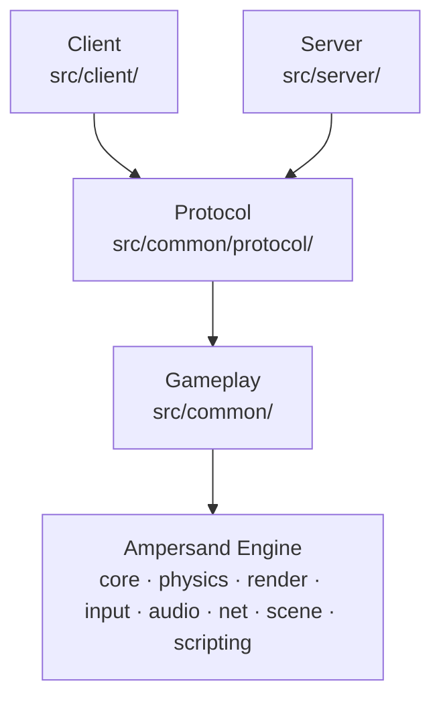

# Architecture

R-Type is split in layers. Each layer only uses the layers below it.



| Layer | Folder | Role |
| --- | --- | --- |
| Engine | fetched with CPM | ECS, physics, rendering, input, audio, network, scenes, Lua: knows nothing about R-Type ([docs](https://boz0o0.github.io/Ampersand-Engine/)) |
| Gameplay | `src/common/` | the components and systems of the game rules ([Gameplay](gameplay.md)) |
| Protocol | `src/common/protocol/` | the packets and their bytes ([Protocol](protocol/specification.md)) |
| Server | `src/server/` | the accounts, the lobby and the parties |
| Client | `src/client/` | the window, the input, the connection, and what the server says, shown |

The headers are in `include/rtype/`, in the same folders.

## Rules

- The engine never includes R-Type code.
- The gameplay never includes the protocol nor the network: it runs and is
  tested without them.
- The protocol uses enums of the gameplay (`EntityKind`, `DeathReason`), never
  the other way around.
- The client and the server never include each other: they only share
  `common`.

## The game folder

The content of the game is data in `game/`, read by the engine
[scene module](https://boz0o0.github.io/Ampersand-Engine/architecture/scene/):
the client reads it from its binary folder (CMake copies it there), the server
from where it runs.

```text
game/
├── assets/          sprites, sounds and fonts (sources in CREDITS.md)
├── scripts/         Lua: menus, HUD, star field, animations, death effects
│   └── server/      the waves and the moving enemies, run by the server
└── world/
    ├── config.json  the client: window, sound, camera, input actions
    ├── server.json  the server: its scene only
    ├── scenes/      game.json (client), server.json (server)
    └── prefabs/     the look of each entity, for the client
        ├── common/  the gameplay of each entity, for both sides
        └── server/  the scripts of some entities, for the server
```

An entity is a prefab of `common/`, inherited by its client prefab (its look)
and by its server prefab (its scripts).

## Server

| Thread | Class | Does |
| --- | --- | --- |
| Network | `ServerNetwork` | reads and decodes every datagram, queues the valid packets |
| Lobby (main) | `Lobby` | logs the clients in, answers the clients in no party, routes the other packets to their party |
| Passwords | `AuthWorker` | checks the passwords against the `AccountStore` (SQLite), so the lobby never waits |
| One per party | `GameServer` | 60 ticks per second: its packets, its `Game`, a snapshot 30 times per second |

The threads only share the socket (behind a mutex) and bounded queues. Details
in [Protocol code](protocol/implementation.md#server-loop).

## Client

The client runs the engine
[`Scheduler`](https://boz0o0.github.io/Ampersand-Engine/architecture/ecs/#scheduler),
with the time of each frame, so the game runs at the same speed on any
computer. Its systems, in order:

| System | Does |
| --- | --- |
| `InputSystem` (engine) | reads the keyboard, the mouse and the controllers |
| `QuitSystem` | Escape or Start: back to the lobby from a room, quits elsewhere |
| `NetworkSystem` | runs the `ServerConnection` (login, lobby, ACKs, ping), applies the game packets to the `WorldMirror`, sends the input |
| `PredictionSystem` | moves our own ship from our input at once |
| `MovementSystem` (engine) | moves the other entities between two snapshots |
| `CorrectionSystem` | slides each entity toward where the server says it is |
| `ScriptingSystem` (engine) | runs the Lua: login, lobby, HUD, star field, animations, death effects |
| `ScriptErrorSystem` | prints a broken script, which the engine turns off |
| `AnimationSystem`, `AudioSystem`, `RenderSystem` (engine) | animate, play the sounds, draw |

`WorldMirror` keeps one entity per server entity, created by the
`PrefabFactory` from the kind, variant and owner sent by the server, and
creates the death effect of an entity that was killed. Lua only drives what is
seen: the server stays the only one to decide what happens.

### Smooth movement

The server sends the positions 30 times per second, late and not exactly every
33 ms. So:

- **The other entities** keep their last speed between two snapshots. A
  difference with a snapshot goes in a `Correction`, absorbed in about 0.1 s;
  more than 128 units (lost snapshots) is jumped at once.
- **Our own ship** moves at once with our input, with the same rule as the
  server (`common::ShipMovement`). Once both our input and the server's ship
  have stopped, it slides to the server's position.

If the server refuses the client, does not answer, or goes silent for 5
seconds, the HUD shows why, and the next key stops the client.
