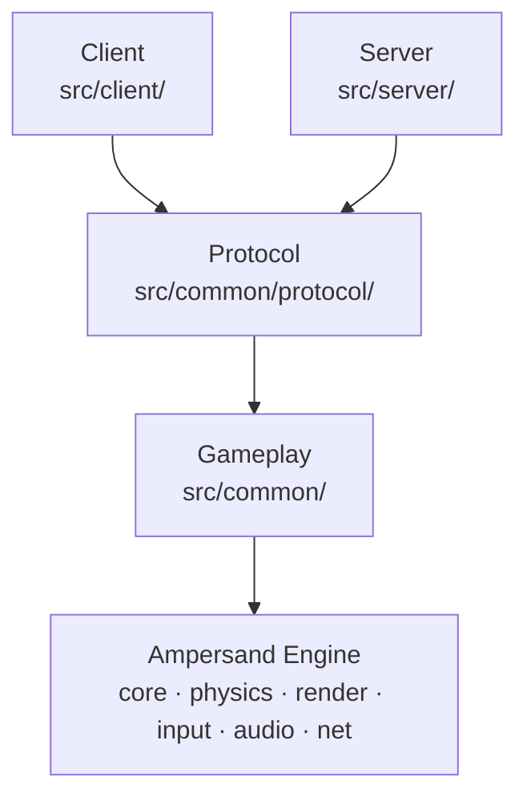

# Architecture

R-Type is split in layers. Each layer only uses the layers below it.

An arrow means "uses".

## Layers

| Layer    | Folder                 | Role                                                                     |
| -------- | ---------------------- | ------------------------------------------------------------------------ |
| Engine   | `ampersand-engine/`    | ECS, physics, rendering, input, audio, UDP socket: knows nothing about R-Type ([docs](https://boz0o0.github.io/Ampersand-Engine/)) |
| Gameplay | `src/common/`          | components, resources and systems of the game rules ([Gameplay](gameplay.md)) |
| Protocol | `src/common/protocol/` | the packets, and how they are turned into bytes and back ([Protocol](protocol/specification.md)) |
| Server   | `src/server/`          | accepts the players and runs the game loop                               |
| Client   | `src/client/`          | opens the window, reads the keyboard, talks to the server                |

The headers are in `include/rtype/`, in the same folders.

## Rules

- The engine never includes R-Type code.
- The gameplay never includes the protocol nor the network: it runs and is
  tested without them.
- The protocol uses two enums of the gameplay (`EntityKind`, `DeathReason`),
  never the other way around.
- The client and the server never include each other: they only share
  `common`.

## Server

Two threads (details in [Code](protocol/implementation.md#server-loop)):

| Thread  | Class           | Does                                                               |
| ------- | --------------- | ------------------------------------------------------------------ |
| Network | `ServerNetwork` | reads every datagram, decodes it, queues the valid packets         |
| Game    | `GameServer`    | 60 ticks per second: handles the queued packets, updates the `World`, sends a snapshot 30 times per second |

The two threads only share the socket (behind a mutex) and a bounded
`MessageQueue`.

## Client

One loop, once per frame:

1. `ServerConnection`: connects to the server, then sends a `PING` every second.
2. `InputSystem` (engine): reads the keyboard and the mouse.
3. `RenderSystem` (engine): draws the `World` in a 1920x1080 view.
