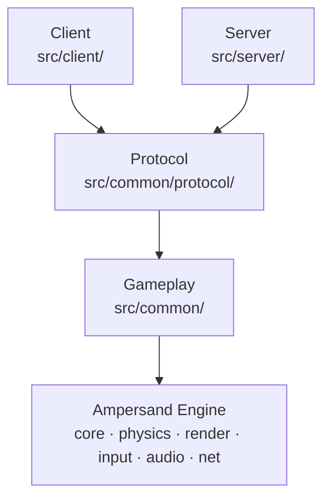

# Architecture

R-Type is split in layers. Each layer only uses the layers below it.

An arrow means "uses".

## Layers

| Layer    | Folder                 | Role                                                                     |
| -------- | ---------------------- | ------------------------------------------------------------------------ |
| Engine   | fetched with CPM       | ECS, physics, rendering, input, audio, UDP socket: knows nothing about R-Type ([docs](https://boz0o0.github.io/Ampersand-Engine/)) |
| Gameplay | `src/common/`          | components, resources and systems of the game rules ([Gameplay](gameplay.md)) |
| Protocol | `src/common/protocol/` | the packets, and how they are turned into bytes and back ([Protocol](protocol/specification.md)) |
| Server   | `src/server/`          | accepts the players and runs the game loop                               |
| Client   | `src/client/`          | opens the window, reads the keyboard, talks to the server, shows and plays what the server says |

The headers are in `include/rtype/`, in the same folders.

## Rules

- The engine never includes R-Type code.
- The gameplay never includes the protocol nor the network: it runs and is
  tested without them.
- The protocol uses two enums of the gameplay (`EntityKind`, `DeathReason`),
  never the other way around.
- The client and the server never include each other: they only share
  `common`.

## Server

Several parties run at once, each on its own thread (details in
[Code](protocol/implementation.md#server-loop)):

| Thread             | Class           | Does                                                               |
| ------------------ | --------------- | ------------------------------------------------------------------ |
| Network            | `ServerNetwork` | reads every datagram, decodes it, queues the valid packets         |
| Lobby (main)       | `Lobby`         | answers the clients in no party (room list, create, join), gives each other packet to the party of its sender, opens and closes the parties |
| One per party      | `GameServer`    | 60 ticks per second: handles its packets, updates its `World`, sends a snapshot 30 times per second |

The threads only share the socket (behind a mutex) and bounded
`MessageQueue`s: no other data is shared.

## Client

Before the loop, `AssetLoader` loads the sprite sheets, the star-field images,
the font and the sounds from the `assets/` folder next to the binary (CMake
copies it there, the sources are in `assets/CREDITS.md`). The client stops if
a file is missing.

`Starfield` then creates the background: two layers of stars (the back one
with a planet and a moon), each drawn twice side by side, behind everything
else. The back layer scrolls left at 30 px/s and the front one at 90 px/s, so
the front stars look closer.

Each frame starts by measuring the real time since the previous one
(`std::chrono::steady_clock`, at most 0.1 s so a frozen window does not make
everything jump) into the engine `Clock`. Every move, scroll and animation
uses it, so the game runs at the same speed on any computer, whatever its
frame rate.

One loop, once per frame:

1. `InputSystem` (engine): reads the keyboard and the mouse. In a room,
   Escape goes back to the lobby; anywhere else, it quits.
2. `ServerConnection`: connects to the server, sends a `PING` every second,
   asks for the room list in the lobby, sends the room requests until they
   are answered, acknowledges the reliable packets and drops their copies,
   then hands out the game packets of the room.
3. `LobbyMenu`, in the lobby: the menu (quick match, create a public or a
   private room, join with a code typed with the letters and digits) and the
   public rooms, chosen with the arrows and Enter. With a party code on the
   command line, the client joins that room at once instead.
4. `Hud`, in a room: our player and the room (or its code, to give to
   friends), our health, lives and score, who joined or left, and the result
   of the game.
5. `WorldMirror`: applies the game packets to the local `World`. It keeps one
   entity per server entity, with the sprite, animation and size of its kind
   (each ship has the colour of its player), plays the sound of our shots,
   and leaves an explosion where a ship or an enemy is killed. It is emptied
   when we leave a room: each room numbers its entities from the start.
6. `Controls`: turns the keys held into a `PLAYER_INPUT`, sent to the server.
7. `MovementSystem` (engine): moves the entities with their speed between two
   snapshots, and the star-field layers.
8. `ScrollingSystem`: once a star-field copy has fully left the screen on the
   left, puts it back behind the other copy, so the background never ends.
9. `AnimationSystem` (engine) and `ExplosionSystem`: play the animations, and
   remove an explosion once its animation and its sound are over.
10. `AudioSystem` (engine): plays the sounds.
11. `RenderSystem` (engine): draws the `World`, the star-field at the back and
    the HUD or the lobby menu on top. The game area is 1920x1080, scaled to
    fit the window.

If the server refuses the client, does not answer, or goes silent for 5
seconds, the HUD shows why and waits: the next key pressed stops the client,
with exit code 84.
