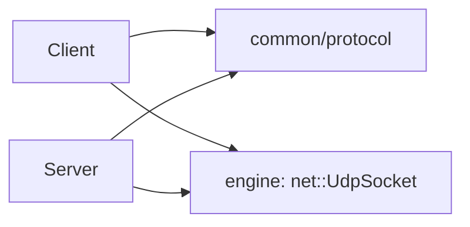

# Protocol code

How the [protocol](specification.md) is done in the code.

## Where is it

The engine's `net` module only sends and receives raw bytes
(`ampersand::net::UdpSocket`). It doesn't know anything about R-Type. The
R-Type packets are in `src/common/protocol/`, so both the client and the
server can use them.



| File | What's inside |
| --- | --- |
| `Protocol.hpp` | constants (port, sizes, timeouts...), packet types, enums, `isReliable()` |
| `PacketHeader.hpp` | the 12-byte header |
| `Packets.hpp` | one struct per packet (`ConnectRequest`, `EntitySpawn`, ...) |
| `BinaryWriter.hpp` | writes numbers/strings in big-endian into a buffer |
| `BinaryReader.hpp` | reads them back, checks we never go past the end |
| `PacketCodec.hpp/.cpp` | `encode()` and `decode()` |
| `tests/common/tests_protocol.cpp` | unit tests |

## Why we did it like this

- We write the fields one by one instead of `memcpy` on a struct. Otherwise
  padding and endianness would change between Windows and Linux.
- A decoded packet is a `std::variant` of all the packet structs. You use
  `std::get_if` or `std::visit` to handle it.
- `decode()` returns an error code instead of throwing. Anyone can send
  garbage to the server, it's normal, we just drop it.
- `encode()` throws a `ProtocolError` if you try to send something wrong (name
  too long, too many entities...). That's a bug in our code, so it should be
  loud.
- `encode()` sets the reliable flag by itself depending on the type, so you
  can't forget it.

## How to use it

Send a packet:

```cpp
#include <ampersand/net/UdpSocket.hpp>
#include "common/protocol/PacketCodec.hpp"

namespace proto = rtype::protocol;

ampersand::net::UdpSocket socket;
auto server = ampersand::net::UdpSocket::resolve("127.0.0.1", proto::DEFAULT_PORT);
std::uint32_t sequence = 0;

auto data = proto::encode(
    proto::PlayerInput{.clientTick = tick,
                       .inputMask = proto::InputFlag::MOVE_UP | proto::InputFlag::SHOOT},
    sequence++);
socket.send(data, server);
```

Receive packets:

```cpp
// +1 so we can see if a packet is too big
std::array<std::byte, proto::MAX_DATAGRAM_SIZE + 1> buffer{};
ampersand::net::Endpoint from;

while (auto length = socket.receive(buffer, from)) {
    proto::Packet packet;
    auto error = proto::decode(std::span(buffer).first(*length), packet);
    if (error != proto::DecodeError::None) {
        continue;  // bad packet, drop it (proto::toString(error) for logs)
    }
    if (packet.header.isReliable()) {
        socket.send(proto::encode(proto::Ack{.sequence = packet.header.sequence},
                                  sequence++), from);
    }
    if (auto* spawn = std::get_if<proto::EntitySpawn>(&packet.payload)) {
        // create the entity
    }
}
```

## Adding a new packet

1. Add it to the [protocol page](specification.md). If old clients can't
   understand it anymore, change `VERSION`.
2. `Protocol.hpp`: add it to `PacketType`. If it's reliable, add it in
   `isReliable()`.
3. `Packets.hpp`: add the struct with its `TYPE`.
4. `PacketCodec.hpp`: add the struct to `Payload`.
5. `PacketCodec.cpp`: add `writePayload` and `readPayload` (check every value
   when reading), and the `case` in `decodePayload`.
6. Add tests in `tests/common/tests_protocol.cpp`.

!!! warning
    `readEnum(value, last)` accepts every value from 0 to `last`. If you add a
    value to an enum, put it at the end and update `last` in
    `PacketCodec.cpp`.

## TODO

For now the code only turns packets into bytes and back. Still to do in the
client/server:

- [ ] Resending reliable packets and ignoring duplicates
- [ ] Player list on the server (IP + port -> player), ping/pong, timeouts
- [ ] Limit the number of packets per IP
