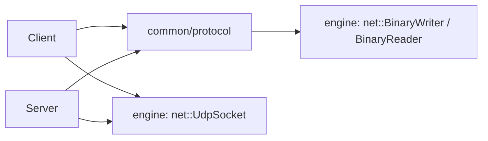
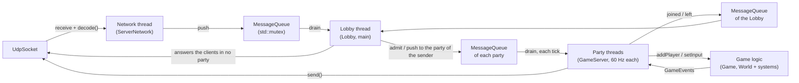
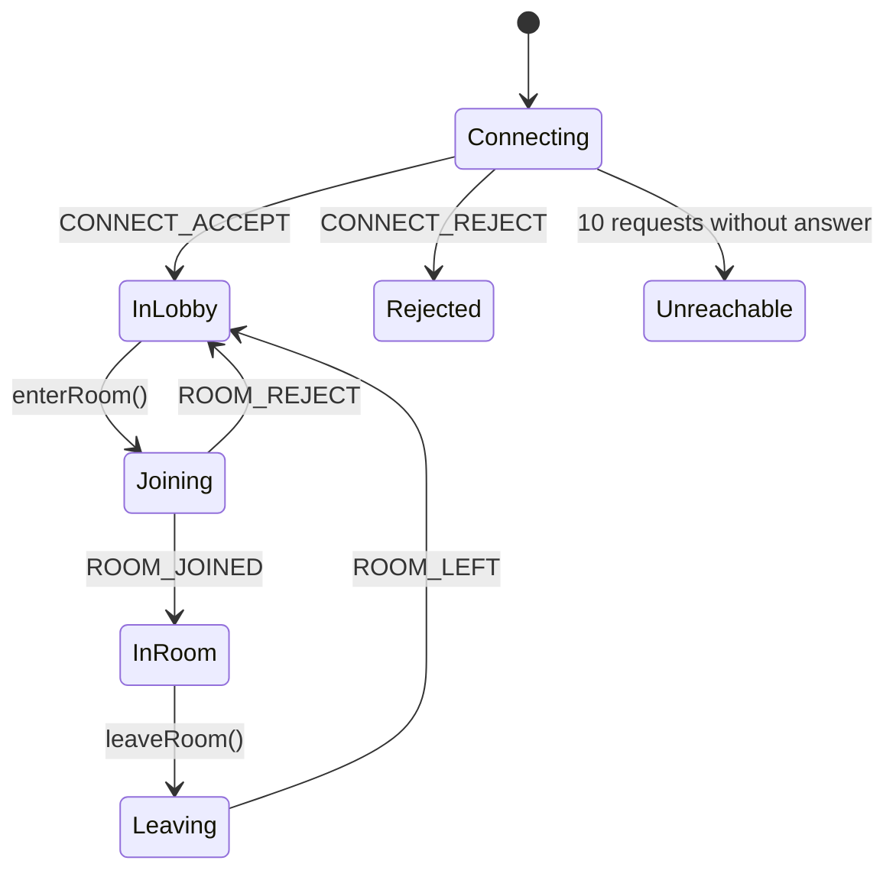

# Protocol code

How the [protocol](specification.md) is done in the code.

## Where is it

The engine's `net` module sends and receives raw bytes
(`ampersand::net::UdpSocket`) and has the generic tools to write and read
big-endian values (`ampersand::net::BinaryWriter` / `BinaryReader`). It doesn't
know anything about R-Type. The R-Type packets are in the `common` module, so
both the client and the server can use them. Like in the engine, headers and
sources are kept apart: headers in `include/rtype/common/protocol/`, sources in
`src/common/protocol/`.



| File | What's inside |
| --- | --- |
| `Protocol.hpp/.cpp` | constants (port, sizes, timeouts...), packet types, enums, `isReliable()` |
| `PacketHeader.hpp` | the 12-byte header |
| `Packets.hpp` | one struct per packet (`ConnectRequest`, `EntitySpawn`, ...) |
| `PacketCodec.hpp/.cpp` | `encode()` and `decode()` |
| `tests/common/tests_protocol.cpp` | unit tests |

The byte tools live in the [engine](https://github.com/Boz0o0/Ampersand-Engine) (`include/ampersand/net/`):

| File | What's inside |
| --- | --- |
| `BinaryWriter.hpp/.cpp` | writes numbers/strings in big-endian into a buffer |
| `BinaryReader.hpp/.cpp` | reads them back, checks we never go past the end |

## Why we did it like this

- We write the fields one by one instead of `memcpy` on a struct. Otherwise
  padding and endianness would change between Windows and Linux.
- A decoded packet is a `std::variant` of all the packet structs. You use
  `std::get_if` or `std::visit` to handle it.
- `decode()` returns an error code instead of throwing. Anyone can send
  garbage to the server, it's normal, we just drop it.
- `encode()` throws a `ProtocolError` if you try to send something wrong (name
  too long, too many entities...). That's a bug in our code, so it should be
  loud.
- `encode()` sets the reliable flag by itself depending on the type, so you
  can't forget it.

## How to use it

Send a packet:

```cpp
#include <ampersand/net/UdpSocket.hpp>
#include <rtype/common/protocol/PacketCodec.hpp>

namespace proto = rtype::protocol;

ampersand::net::UdpSocket socket;
auto server = ampersand::net::UdpSocket::resolve("127.0.0.1", proto::DEFAULT_PORT);
std::uint32_t sequence = 0;

auto data = proto::encode(
    proto::PlayerInput{.clientTick = tick,
                       .inputMask = proto::InputFlag::MOVE_UP | proto::InputFlag::SHOOT},
    sequence++);
socket.send(data, server);
```

Receive packets:

```cpp
// +1 so we can see if a packet is too big
std::array<std::byte, proto::MAX_DATAGRAM_SIZE + 1> buffer{};
ampersand::net::Endpoint from;

while (auto length = socket.receive(buffer, from)) {
    proto::Packet packet;
    auto error = proto::decode(std::span(buffer).first(*length), packet);
    if (error != proto::DecodeError::None) {
        continue;  // bad packet, drop it (proto::toString(error) for logs)
    }
    if (packet.header.isReliable()) {
        socket.send(proto::encode(proto::Ack{.sequence = packet.header.sequence},
                                  sequence++), from);
    }
    if (auto* spawn = std::get_if<proto::EntitySpawn>(&packet.payload)) {
        // create the entity
    }
}
```

## Adding a new packet

1. Add it to the [protocol page](specification.md). If old clients can't
   understand it anymore, change `VERSION`.
2. `Protocol.hpp`: add it to `PacketType`. If it's reliable, add it in
   `isReliable()`.
3. `Packets.hpp`: add the struct with its `TYPE`.
4. `PacketCodec.hpp`: add the struct to `Payload`.
5. `PacketCodec.cpp`: add `writePayload` and `readPayload` (check every value
   when reading), and the `case` in `decodePayload`.
6. Add tests in `tests/common/tests_protocol.cpp`.

!!! warning
    `readEnum(value, last)` accepts every value from 0 to `last`. If you add a
    value to an enum, put it at the end and update `last` in
    `PacketCodec.cpp`.

## Server loop

The server runs one network thread, one lobby thread and one thread per
party, in `src/server/` (headers in `include/rtype/server/`):



- **Network thread** (`ServerNetwork`): reads every datagram, runs `decode()`
  and pushes the valid packets into a `MessageQueue`. Bad packets (empty, too
  short, bad magic...) are logged and dropped there, they never reach the
  game. The queue is bounded (`MAX_QUEUED_MESSAGES`), so a flood can't eat all
  the memory, and a `RateLimiter` drops what a sender sends past
  `MAX_PACKETS_PER_SECOND`.
- **Lobby thread** (`Lobby::run`, the main thread): keeps every client (IP +
  port -> name, party). A `CONNECT_REQUEST` from a new address makes it a
  client of the lobby (256 at most). The Lobby answers the clients in no party
  itself: `PING`, `ROOM_LIST` (at most every 250 ms per client),
  `ROOM_CREATE` (always a new party; a private one gets a code of 6 digits)
  and `ROOM_JOIN` (by room id, by code, or the first public party with a free
  place), and drops them after 5 s of silence. To put a client in a party, it
  routes the client there and calls `GameServer::admit()`. Then it gives
  every packet of that client to its party. 16 parties at most, then
  `ROOM_REJECT(server full)`. A party is closed as soon as it is empty, and
  its code is freed.
- **Party threads** (`GameServer::run`): one per party, each with its own
  `Game` and `World`. 60 times per second, even when no client sends
  anything, it takes the clients and packets the Lobby gave it (it answers
  an admission with `ROOM_JOINED`, or `ROOM_REJECT` when it is full), runs one tick of its
  `Game`, sends its events to its clients, and sends a `WORLD_SNAPSHOT` every
  2 ticks (30 per second, split when there are more than 59 entities).
- Only the Lobby touches its table of clients. A party tells it who joined,
  who left the server (quit, timeout) and who went back to the lobby
  (`ROOM_LEAVE`) with a `SessionChange` through a `MessageQueue`, which the
  Lobby reads before routing new packets. For a client back in the lobby, the
  Lobby sends `ROOM_LEFT` itself, so the client never asks the Lobby
  something before the Lobby knows it is back.
- The socket is shared by every thread, so every use of it locks a mutex.
  Logs go through `logLine()`, so lines of two threads never get mixed.
- `Ctrl+C` stops the loop: every party, and the Lobby for the clients in no
  party, sends `DISCONNECT(server shutdown)` and the server exits.

| File | What's inside |
| --- | --- |
| `ServerNetwork` | the socket, the network thread, `send()` / `encode()` + `sendDatagram()` |
| `MessageQueue` | the bounded queue between two threads |
| `RateLimiter` | packets per sender per second |
| `Lobby` | the clients, the ones in no party (room list, create, join, timeout), the parties, and which client plays in which party |
| `GameServer` | one party: its clients (IP + port -> player), PING/PONG, timeouts, admissions, `ROOM_LEAVE` and quits, turns `GameEvents` into packets |
| `Log.hpp` | `logLine()`, one whole line per call, whatever the thread |
| `ReliableOutbox` | the reliable packets of one client waiting for their ACK |
| `Game` | the game logic: `World`, systems, ships, lives, score, game phases |
| `WaveSystem` | the waves of Bydos of a level |
| `GameEvents.hpp` | what `Game::update()` returns: spawns, deaths, player changes, start/end |

### Game logic and network are apart

`Game` knows nothing about packets or sockets: `GameServer` calls
`addPlayer()`, `removePlayer()` and `setInput()` from what it receives, and
`Game::update()` returns a list of `GameEvent` (`EntitySpawned`,
`EntityDestroyed`, `PlayerChanged`, `GameStarted`, `GameEnded`) that
`GameServer::toPacket()` turns into `ENTITY_SPAWN`, `ENTITY_DESTROY`,
`PLAYER_STATE`, `GAME_START` and `GAME_OVER`. So the rules can be tested
without the network (`tests/server/tests_game.cpp`).

One tick of `Game::update()`:

1. Phase: start a game when a player is there, restart one 5 s after it ended.
2. Waves (`WaveSystem`), ships that come back, inputs -> speed and trigger.
3. `ShootingSystem`, `MovementSystem`, ships kept on the screen,
   `CollisionSystem`, `DamageSystem`, `OutOfScreenSystem`.
4. Rules: lost ships take a life, enemies shot down give score to the owner
   of the missile, every ship lost = defeat, every wave beaten = victory.
5. Events: each new entity gets a `NetworkId` (never reused) and an
   `EntitySpawned`; each death with a `NetworkId` gives an `EntityDestroyed`.
   An entity born and dead in the same tick is never sent.
6. `CleanupSystem`.

### Reliable packets

`GameServer::sendTo()` looks at `isReliable()`: a reliable packet is encoded
once (`ServerNetwork::encode()`), sent, and kept in the `ReliableOutbox` of
the client. Every tick, packets without ACK for 100 ms are sent again with
the same bytes. When an ACK comes, the packet is forgotten. After 20 sends
without ACK, the client is removed with `PLAYER_LEFT(timeout)`: it crashed.
The client sends no reliable packet, so the server never needs to drop
duplicates.

On the client, `ServerConnection` sends `CONNECT_REQUEST` every 500 ms (10
tries max) until the server answers `CONNECT_ACCEPT`, then sends a `PING`
every second so the server doesn't time it out. It answers every reliable
packet with an `ACK` and drops the copies it already handled.

Its states:



From any state but `Connecting`, `DISCONNECT` or 5 s without any packet from
the server leads to `Disconnected`. In the lobby it sends `ROOM_LIST` every
second (`rooms()`); in `Joining` and `Leaving` it sends its request every
500 ms until the answer comes. It only hands out the game packets
(`0x20`-`0x3F`) while `Joining` or `InRoom`: those of a room it left are
acknowledged and dropped.

## TODO

Still to do in the client/server:

- [x] Resending reliable packets and ignoring duplicates
- [x] Player list on the server (IP + port -> player), PING/PONG, server-side timeouts
- [x] `PLAYER_JOINED` / `PLAYER_LEFT` / `ENTITY_SPAWN` when a player joins or leaves
- [x] Entities in `WORLD_SNAPSHOT`
- [x] Limit the number of packets per sender
- [x] Client: use `PLAYER_STATE` / `GAME_OVER` (HUD with lives and score)
