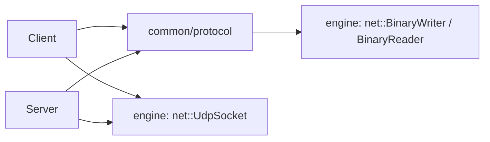
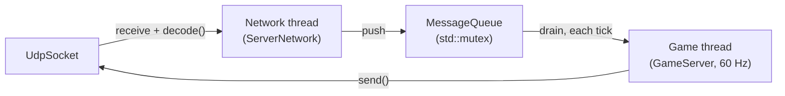

# Protocol code

How the [protocol](specification.md) is done in the code.

## Where is it

The engine's `net` module sends and receives raw bytes
(`ampersand::net::UdpSocket`) and has the generic tools to write and read
big-endian values (`ampersand::net::BinaryWriter` / `BinaryReader`). It doesn't
know anything about R-Type. The R-Type packets are in the `common` module, so
both the client and the server can use them. Like in the engine, headers and
sources are kept apart: headers in `include/rtype/common/protocol/`, sources in
`src/common/protocol/`.



| File | What's inside |
| --- | --- |
| `Protocol.hpp/.cpp` | constants (port, sizes, timeouts...), packet types, enums, `isReliable()` |
| `PacketHeader.hpp` | the 12-byte header |
| `Packets.hpp` | one struct per packet (`ConnectRequest`, `EntitySpawn`, ...) |
| `PacketCodec.hpp/.cpp` | `encode()` and `decode()` |
| `tests/common/tests_protocol.cpp` | unit tests |

The byte tools live in the engine (`ampersand-engine/include/ampersand/net/`):

| File | What's inside |
| --- | --- |
| `BinaryWriter.hpp/.cpp` | writes numbers/strings in big-endian into a buffer |
| `BinaryReader.hpp/.cpp` | reads them back, checks we never go past the end |

## Why we did it like this

- We write the fields one by one instead of `memcpy` on a struct. Otherwise
  padding and endianness would change between Windows and Linux.
- A decoded packet is a `std::variant` of all the packet structs. You use
  `std::get_if` or `std::visit` to handle it.
- `decode()` returns an error code instead of throwing. Anyone can send
  garbage to the server, it's normal, we just drop it.
- `encode()` throws a `ProtocolError` if you try to send something wrong (name
  too long, too many entities...). That's a bug in our code, so it should be
  loud.
- `encode()` sets the reliable flag by itself depending on the type, so you
  can't forget it.

## How to use it

Send a packet:

```cpp
#include <ampersand/net/UdpSocket.hpp>
#include <rtype/common/protocol/PacketCodec.hpp>

namespace proto = rtype::protocol;

ampersand::net::UdpSocket socket;
auto server = ampersand::net::UdpSocket::resolve("127.0.0.1", proto::DEFAULT_PORT);
std::uint32_t sequence = 0;

auto data = proto::encode(
    proto::PlayerInput{.clientTick = tick,
                       .inputMask = proto::InputFlag::MOVE_UP | proto::InputFlag::SHOOT},
    sequence++);
socket.send(data, server);
```

Receive packets:

```cpp
// +1 so we can see if a packet is too big
std::array<std::byte, proto::MAX_DATAGRAM_SIZE + 1> buffer{};
ampersand::net::Endpoint from;

while (auto length = socket.receive(buffer, from)) {
    proto::Packet packet;
    auto error = proto::decode(std::span(buffer).first(*length), packet);
    if (error != proto::DecodeError::None) {
        continue;  // bad packet, drop it (proto::toString(error) for logs)
    }
    if (packet.header.isReliable()) {
        socket.send(proto::encode(proto::Ack{.sequence = packet.header.sequence},
                                  sequence++), from);
    }
    if (auto* spawn = std::get_if<proto::EntitySpawn>(&packet.payload)) {
        // create the entity
    }
}
```

## Adding a new packet

1. Add it to the [protocol page](specification.md). If old clients can't
   understand it anymore, change `VERSION`.
2. `Protocol.hpp`: add it to `PacketType`. If it's reliable, add it in
   `isReliable()`.
3. `Packets.hpp`: add the struct with its `TYPE`.
4. `PacketCodec.hpp`: add the struct to `Payload`.
5. `PacketCodec.cpp`: add `writePayload` and `readPayload` (check every value
   when reading), and the `case` in `decodePayload`.
6. Add tests in `tests/common/tests_protocol.cpp`.

!!! warning
    `readEnum(value, last)` accepts every value from 0 to `last`. If you add a
    value to an enum, put it at the end and update `last` in
    `PacketCodec.cpp`.

## Server loop

The server runs two threads, in `src/server/` (headers in
`include/rtype/server/`):



- **Network thread** (`ServerNetwork`): reads every datagram, runs `decode()`
  and pushes the valid packets into a `MessageQueue`. Bad packets (empty, too
  short, bad magic...) are logged and dropped there, they never reach the
  game. The queue is bounded (`MAX_QUEUED_MESSAGES`), so a flood can't eat all
  the memory.
- **Game thread** (`GameServer::run`): 60 times per second, even when no
  client sends anything, it takes the queued packets, updates the `World`, and
  sends a `WORLD_SNAPSHOT` to every client every 2 ticks (30 per second).
- The socket is shared by both threads, so every use of it locks a mutex.
- `Ctrl+C` stops the loop: the server sends `DISCONNECT(server shutdown)` to
  every client and exits.

On the client, `ServerConnection` sends `CONNECT_REQUEST` every 500 ms (10
tries max) until the server answers `CONNECT_ACCEPT` with its player id, then
sends a `PING` every second so the server doesn't time it out.

## TODO

Still to do in the client/server:

- [ ] Resending reliable packets and ignoring duplicates
- [x] Player list on the server (IP + port -> player), PING/PONG, server-side timeouts
- [ ] `PLAYER_JOINED` / `PLAYER_LEFT` / `ENTITY_SPAWN` when a player joins or leaves
- [ ] Entities in `WORLD_SNAPSHOT` (empty for now, only `serverTick` moves)
- [ ] Limit the number of packets per IP
