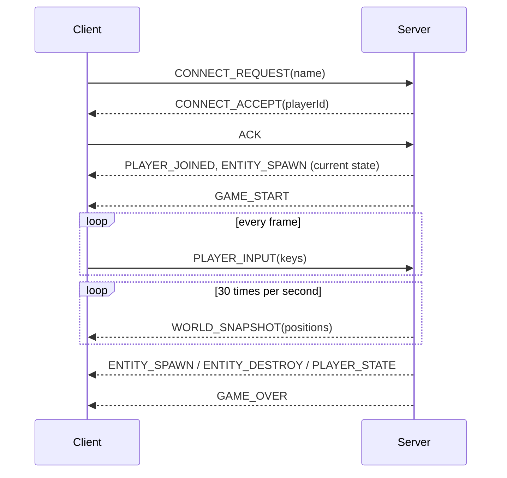
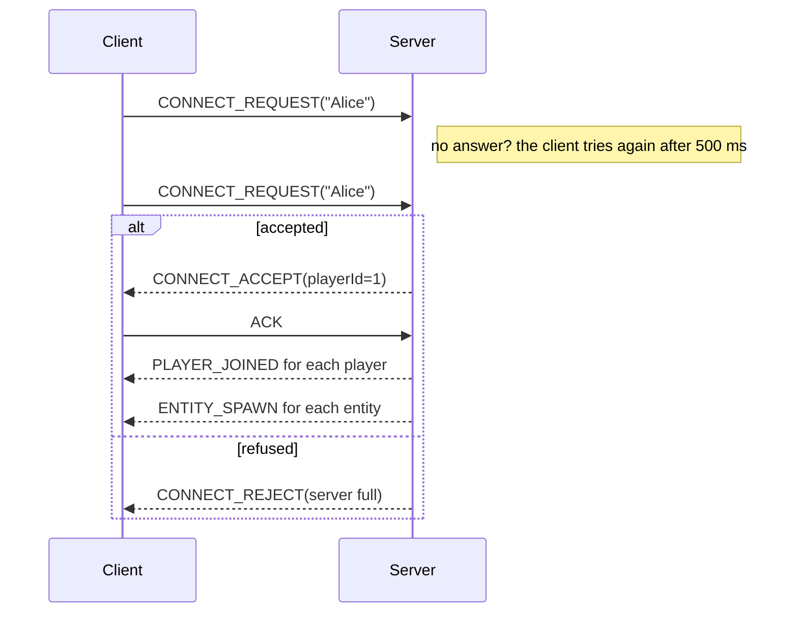

# Network Protocol

This page explains how the client and the server talk to each other.
If you want to write your own client, everything you need should be here.

Quick facts:

- Transport: **UDP** only (IPv4)
- Default port: **4242**
- Binary protocol, current version: **1**
- Code: `include/rtype/common/protocol/` and `src/common/protocol/` (see [Implementation](implementation.md))

The server runs the game. The client only sends the player's inputs and draws
what the server tells it. If the client and the server disagree, the server
is right.

## How a game goes



## Data types

All numbers are sent in **big-endian** (network byte order). There is no
padding between fields: we write them one after the other. Don't send your
C++ structs directly with `memcpy`, it won't work between different
compilers/OS.

| Type | Size | Notes |
| --- | --- | --- |
| `u8` | 1 | unsigned |
| `u16` | 2 | unsigned, big-endian |
| `u32` | 4 | unsigned, big-endian |
| `f32` | 4 | float (IEEE 754), sent like a `u32`. NaN and infinity are not allowed |
| `string` | 1 + n | one `u8` for the length, then n bytes of UTF-8 (no `\0` at the end) |
| `enum` | 1 | a `u8`, only the values listed below are valid |

Coordinates: the world is 1920 x 1080, (0, 0) is the top-left corner, x goes
right and y goes down. Speeds are in units per second. Entities can be
outside the screen (for example Bydos coming from the right).

## Packet header

Every packet starts with the same 12 bytes:

| Offset | Field | Type | What it is |
| --- | --- | --- | --- |
| 0 | `magic` | `u16` | always `0x5254` ("RT") |
| 2 | `version` | `u8` | protocol version, `1` for now |
| 3 | `type` | `u8` | packet type (see list below) |
| 4 | `flags` | `u8` | `0x01` = reliable, the other bits are unused |
| 5 | `reserved` | `u8` | unused, send 0 |
| 6 | `payloadSize` | `u16` | size of the data after the header |
| 8 | `sequence` | `u32` | packet counter of the sender |

Then come `payloadSize` bytes of data, depending on the type.

A full packet is at most **1200 bytes** (header included), so the data part is
at most 1188 bytes. We picked 1200 so packets don't get split on the
internet. One UDP datagram = one packet.

## Packet list

| Type | Name | Who sends it | Reliable | Data size |
| --- | --- | --- | --- | --- |
| `0x01` | [CONNECT_REQUEST](#connect_request-0x01) | client | no | 1 + n |
| `0x02` | [CONNECT_ACCEPT](#connect_accept-0x02) | server | yes | 2 |
| `0x03` | [CONNECT_REJECT](#connect_reject-0x03) | server | no | 1 |
| `0x04` | [DISCONNECT](#disconnect-0x04) | both | no | 1 |
| `0x05` | [PING](#ping-0x05) | both | no | 4 |
| `0x06` | [PONG](#pong-0x06) | both | no | 4 |
| `0x07` | [ACK](#ack-0x07) | both | no | 4 |
| `0x10` | [PLAYER_INPUT](#player_input-0x10) | client | no | 5 |
| `0x20` | [GAME_START](#game_start-0x20) | server | yes | 4 |
| `0x21` | [PLAYER_JOINED](#player_joined-0x21) | server | yes | 2 + n |
| `0x22` | [PLAYER_LEFT](#player_left-0x22) | server | yes | 2 |
| `0x23` | [ENTITY_SPAWN](#entity_spawn-0x23) | server | yes | 22 |
| `0x24` | [ENTITY_DESTROY](#entity_destroy-0x24) | server | yes | 5 |
| `0x25` | [WORLD_SNAPSHOT](#world_snapshot-0x25) | server | no | 6 + 20 x n |
| `0x26` | [PLAYER_STATE](#player_state-0x26) | server | yes | 7 |
| `0x27` | [GAME_OVER](#game_over-0x27) | server | yes | 5 |

`0x00` and every value not in this list are invalid. The reliable flag is set
on the "yes" packets and only on them.

### Enums

**EntityKind** (`rtype::common`, in `Kind.hpp`): `0` ship, `1` enemy, `2` player
missile, `3` enemy missile, `4` power-up, `5` obstacle.

**DeathReason** (`rtype::common`, in `Deaths.hpp`): `0` killed, `1` out of
screen, `2` collected.

**DisconnectReason**: `0` quit, `1` timeout, `2` kicked, `3` server shutdown.

**RejectReason**: `0` server full, `1` game already started, `2` wrong version,
`3` invalid name.

**GameResult**: `0` victory, `1` defeat.

Player ids go from `0` to `3` (4 players max). `0xFF` means "no player".

### Connection packets

#### CONNECT_REQUEST (0x01)

Sent by the client to join the game.

| Offset | Field | Type | Notes |
| --- | --- | --- | --- |
| 0 | `playerName` | `string` | 1 to 16 bytes |

#### CONNECT_ACCEPT (0x02)

The server accepted the client.

| Offset | Field | Type | Notes |
| --- | --- | --- | --- |
| 0 | `playerId` | `u8` | id of this player (0 to 3) |
| 1 | `tickRate` | `u8` | server ticks per second (60), never 0 |

#### CONNECT_REJECT (0x03)

The server refused the client. The client stops trying.

| Offset | Field | Type | Notes |
| --- | --- | --- | --- |
| 0 | `reason` | `RejectReason` | |

We will never change the header or this packet in future versions, so an old
client can still understand a "wrong version" answer.

#### DISCONNECT (0x04)

The client is leaving, or the server closes the connection.

| Offset | Field | Type | Notes |
| --- | --- | --- | --- |
| 0 | `reason` | `DisconnectReason` | client sends "quit", server sends "kicked" or "server shutdown" |

#### PING (0x05)

Used to check the other side is still alive and to measure the lag.

| Offset | Field | Type | Notes |
| --- | --- | --- | --- |
| 0 | `timestampMs` | `u32` | time of the sender in ms |

#### PONG (0x06)

Answer to a PING.

| Offset | Field | Type | Notes |
| --- | --- | --- | --- |
| 0 | `timestampMs` | `u32` | same value as in the PING. Ping = now - timestampMs |

#### ACK (0x07)

Says "I got your reliable packet".

| Offset | Field | Type | Notes |
| --- | --- | --- | --- |
| 0 | `sequence` | `u32` | `sequence` of the packet we got |

### Client packets

#### PLAYER_INPUT (0x10)

The keys pressed by the player during one frame.

| Offset | Field | Type | Notes |
| --- | --- | --- | --- |
| 0 | `clientTick` | `u32` | frame number of the client, always goes up |
| 4 | `inputMask` | `u8` | one bit per key, see below |

| Bit | Value | Key |
| --- | --- | --- |
| 0 | `0x01` | up |
| 1 | `0x02` | down |
| 2 | `0x04` | left |
| 3 | `0x08` | right |
| 4 | `0x10` | shoot |

The other bits must be 0, otherwise the packet is dropped.

### Server packets

#### GAME_START (0x20)

The game starts.

| Offset | Field | Type | Notes |
| --- | --- | --- | --- |
| 0 | `serverTick` | `u32` | server tick when the game starts |

#### PLAYER_JOINED (0x21)

A player is in the game.

| Offset | Field | Type | Notes |
| --- | --- | --- | --- |
| 0 | `playerId` | `u8` | 0 to 3 |
| 1 | `playerName` | `string` | 1 to 16 bytes |

#### PLAYER_LEFT (0x22)

A player left the game. When a client crashes, the others get this with the
reason "timeout".

| Offset | Field | Type | Notes |
| --- | --- | --- | --- |
| 0 | `playerId` | `u8` | 0 to 3 |
| 1 | `reason` | `DisconnectReason` | |

#### ENTITY_SPAWN (0x23)

A new entity appears: a ship, a Bydos, a missile, a power-up...

| Offset | Field | Type | Notes |
| --- | --- | --- | --- |
| 0 | `entityId` | `u32` | unique id, never reused in the same game |
| 4 | `entityType` | `EntityKind` | tells the client which sprite to use |
| 5 | `ownerId` | `u8` | player who owns it, or `0xFF` |
| 6 | `x` | `f32` | position |
| 10 | `y` | `f32` | |
| 14 | `velocityX` | `f32` | speed |
| 18 | `velocityY` | `f32` | |

The client uses `ownerId` to give each player ship a different color.

#### ENTITY_DESTROY (0x24)

An entity is removed.

| Offset | Field | Type | Notes |
| --- | --- | --- | --- |
| 0 | `entityId` | `u32` | |
| 4 | `reason` | `DeathReason` | only "killed" shows an explosion |

#### WORLD_SNAPSHOT (0x25)

Positions and speeds of the entities at a given tick.

| Offset | Field | Type | Notes |
| --- | --- | --- | --- |
| 0 | `serverTick` | `u32` | tick of this snapshot |
| 4 | `count` | `u16` | number of entities, 59 max |
| 6 | `entities` | list | `count` entries of 20 bytes |

Each entry:

| Offset | Field | Type |
| --- | --- | --- |
| 0 | `entityId` | `u32` |
| 4 | `x` | `f32` |
| 8 | `y` | `f32` |
| 12 | `velocityX` | `f32` |
| 16 | `velocityY` | `f32` |

`payloadSize` has to be exactly `6 + 20 x count`. If there are more than 59
entities, the server sends several snapshots with the same `serverTick`.

#### PLAYER_STATE (0x26)

Health, lives or score of a player changed.

| Offset | Field | Type | Notes |
| --- | --- | --- | --- |
| 0 | `playerId` | `u8` | 0 to 3 |
| 1 | `health` | `u8` | 0 = ship destroyed |
| 2 | `lives` | `u8` | ships left, counting the one on screen (or coming back). 0 = out of the game |
| 3 | `score` | `u32` | 100 points per Bydos shot down |

#### GAME_OVER (0x27)

End of the game.

| Offset | Field | Type | Notes |
| --- | --- | --- | --- |
| 0 | `result` | `GameResult` | |
| 1 | `finalScore` | `u32` | score of the team |

## Reliable packets

UDP can lose packets, send them twice or in the wrong order. We have two kinds
of packets:

- **Normal packets** (inputs, snapshots, ping): we send them all the time, so
  if one is lost the next one replaces it. Nothing special to do.
- **Reliable packets** (flag `0x01`): important events (spawn, death,
  score...). They must arrive, so we use ACKs.

The `sequence` field: each side has its own counter and adds 1 for every new
packet it sends. When a reliable packet is sent again, it keeps the same
sequence.

**When you send a reliable packet:**

1. Keep it in a list.
2. If you didn't get an ACK after 100 ms, send it again (same bytes).
3. When the ACK arrives, remove it from the list.
4. After 20 tries without an ACK (about 2 seconds), consider the other side as
   disconnected.

**When you receive a reliable packet:**

1. Always send an ACK back, even if you already got this packet before (maybe
   your first ACK got lost).
2. Only handle it once. Keep the sequences you received in the last 5 seconds
   to spot the duplicates.

**Packets in the wrong order:**

- Snapshot older than the last one (smaller `serverTick`): ignore it. Same
  tick is fine (split snapshot).
- Input with a `clientTick` not bigger than the last one: ignore it.
- Snapshot entry for an entity the client doesn't know yet: ignore it, the
  ENTITY_SPAWN will arrive.
- ENTITY_DESTROY for an unknown entity: remember the id, and ignore the
  ENTITY_SPAWN if it comes later.
- PLAYER_STATE: only keep the one with the biggest `sequence`.

## Connection



- The client sends CONNECT_REQUEST every 500 ms until it gets an answer. It
  gives up after 10 tries.
- The server knows a client by its **IP + port**. If the same IP + port sends
  CONNECT_REQUEST again, the server sends the same CONNECT_ACCEPT again, it
  doesn't create a new player.
- The server refuses when there are already 4 players, when the name is not
  valid UTF-8 or holds control characters, or (if it wants) when the game
  already started. If the version is different, it answers "wrong version".
  Our server lets players join a running game.
- After accepting, the server sends the new client everything it needs:
  a PLAYER_JOINED per player (him included), an ENTITY_SPAWN per entity, a
  PLAYER_STATE per other player, and GAME_START if a game is running.
  The other clients get a PLAYER_JOINED, then everyone gets the ENTITY_SPAWN
  and the PLAYER_STATE of the new ship on the next tick.

## During the game

- The server sends GAME_START when the game starts: as soon as the first
  player joins. A player who joins later gets it right away.
- The client sends PLAYER_INPUT every frame (at least 60 per second) and right
  away when a key changes. The server uses the last input of each player at
  each tick. Inputs sent before GAME_START are ignored.
- The server sends WORLD_SNAPSHOT 30 times per second. Between two snapshots,
  the client moves the entities with their speed so it looks smooth.
- Every event (spawn, missile fired, death, score change...) is sent to
  **all** the clients as a reliable packet.
- At the end the server sends GAME_OVER: "defeat" when every ship is lost
  (each player has 3 lives, a lost ship comes back after 2 seconds),
  "victory" when every wave of Bydos is beaten. Every entity left is
  destroyed (ENTITY_DESTROY), and 5 seconds later a new game starts with a
  new GAME_START.

## Disconnection and timeout

- A client that quits sends DISCONNECT(quit) a few times (it's not reliable),
  then closes.
- The server sends DISCONNECT(server shutdown) when it stops, or
  DISCONNECT(kicked) to remove a player.
- Both sides send a PING every second, and answer a PING with a PONG.
- Every valid packet counts as "still alive". If nothing comes from someone for
  **5 seconds**, he is disconnected.
- When a player leaves (quit, timeout, kick), the server removes his ship with
  ENTITY_DESTROY and sends PLAYER_LEFT to the others. The game keeps going for
  them. That's how a crashed client is handled.

## Bad packets

When we receive something, we check it in this order. If a check fails, the
packet is **dropped**: no answer, no crash.

1. At least 12 bytes
2. At most 1200 bytes
3. `magic` is `0x5254`
4. `version` is 1 (if it's a CONNECT_REQUEST, the server can answer "wrong
   version")
5. `payloadSize` = packet size - 12
6. `type` is in the list
7. The data has exactly the right size, enums and ids are valid, floats are
   not NaN/infinity, strings are not too long
8. Right direction: the server drops server packets, the client drops client
   packets
9. Right sender: the server only accepts CONNECT_REQUEST from unknown IPs, the
   client only listens to the server

Sizes are always checked against the real number of bytes before allocating
anything. So a fake `count` or string length can't make us allocate a lot of
memory or read outside the buffer.

## Security

- There is no encryption and no login. The protocol is made for LAN games.
- Someone who can fake his IP could pretend to be another player.
- The answer to an unknown IP (CONNECT_REJECT, 13 bytes) is always smaller
  than the request (at least 14 bytes), so the server can't be used for a
  DDoS amplification attack.
- The server accepts at most 500 packets per second from one sender (IP +
  port) and drops the rest. It counts per IP + port, not per IP, so that
  several players can play from the same machine; it counts at most 1024
  senders per second, so spoofed addresses can't make it use more memory.

## Constants

| Name | Value |
| --- | --- |
| `MAGIC` | `0x5254` |
| `VERSION` | `1` |
| `DEFAULT_PORT` | `4242` |
| `HEADER_SIZE` | 12 bytes |
| `MAX_DATAGRAM_SIZE` | 1200 bytes |
| `MAX_PAYLOAD_SIZE` | 1188 bytes |
| `MAX_PLAYERS` | 4 |
| `MAX_PLAYER_NAME_LENGTH` | 16 bytes |
| `NO_OWNER` | `0xFF` |
| `MAX_SNAPSHOT_ENTITIES` | 59 |
| `SERVER_TICK_RATE` | 60 per second |
| `SNAPSHOT_RATE` | 30 per second |
| `RESEND_INTERVAL_MS` | 100 ms |
| `MAX_SEND_ATTEMPTS` | 20 |
| `PING_INTERVAL_MS` | 1000 ms |
| `TIMEOUT_MS` | 5000 ms |

## Examples

PLAYER_INPUT, sequence 42, frame 500, up + shoot:

```text
52 54 01 10 00 00 00 05 00 00 00 2A | 00 00 01 F4 11
magic ver type flags res size seq   | clientTick  keys
```

ENTITY_DESTROY of entity 1234 (killed), sequence 7, reliable:

```text
52 54 01 24 01 00 00 05 00 00 00 07 | 00 00 04 D2 00
```

The ACK the client sends back for it:

```text
52 54 01 07 00 00 00 04 00 00 00 2B | 00 00 00 07
```
